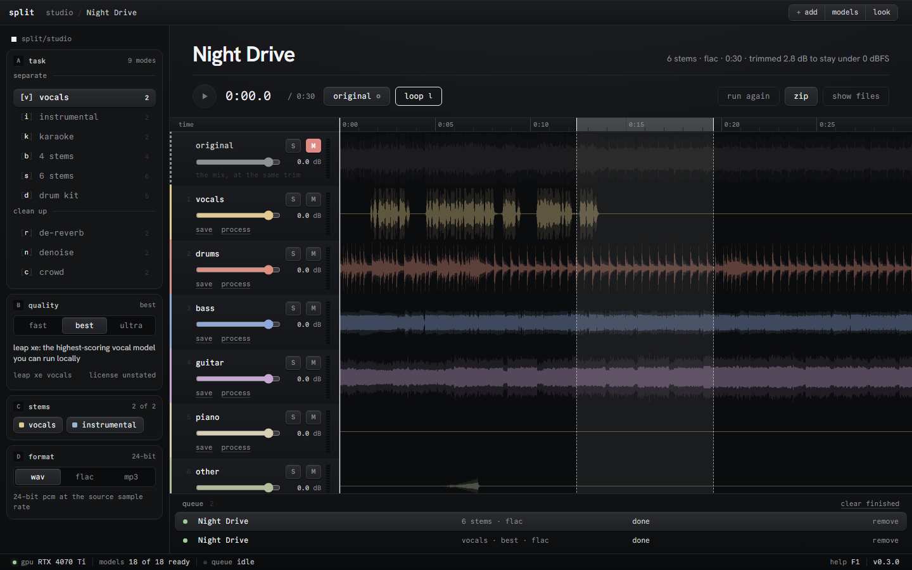

<p align="center">
  
</p>

split pulls a song apart into stems on your own GPU: vocals, karaoke, four or six band stems, a drum kit, and cleanup for reverb, noise and crowds. It runs the best separation models you can download, so nothing is uploaded and there is no queue.



- downloads: [GitHub Releases](https://github.com/zeo/split/releases)
- needs: Windows and an NVIDIA RTX 20-series card or newer
- license: MIT or Apache-2.0 (models have their own, see [License](#license))

Drop in songs or a whole folder, pick a task, and each stem gets its own lane under the original mix. Solo, mute and ride the gain, press O to compare against the original, drag across the ruler to loop a section. Save one stem, export them all, grab a zip, or send a stem on to another task, like a vocal into de-reverb.

## Install

Run `split-<version>-online-setup.exe` from the [releases page](https://github.com/zeo/split/releases). It downloads about 2.1 GB, checks the signature, and adds a Start menu entry and an uninstaller. split tells you when an update is out and installs it when you say so.

Use a driver from the R580 branch or newer. Without a supported GPU split runs on the CPU, which takes minutes per song. Models download the first time a task needs them: 270 MB for Vocals, 700 MB for 4 or 6 stems, up to 2.1 GB for Instrumental Ultra.

## Tasks

| Task | Stems | Best model |
|---|---|---|
| Vocals | vocals, instrumental, or lead, back, instrumental | unwa Leap Xe, plus anvuew karaoke for lead and back |
| Instrumental | instrumental, vocals | unwa Leap Xe, or Leap instrumental for a fuller mix |
| Karaoke | lead, backing | anvuew BS-RoFormer karaoke, Ultra adds frazer/becruily and Gabox |
| 4 stems | vocals, drums, bass, other | BS-RoFormer SW |
| 6 stems | vocals, drums, bass, guitar, piano, other | BS-RoFormer SW |
| Drum kit | kick, snare, toms, hihat, cymbals | SW, then DrumSep 5-stem |
| De-reverb | dry, reverb | anvuew BS de-reverb |
| Denoise | clean, noise, at Mild, Normal or Aggressive | aufr33 denoise |
| Crowd | clean, crowd | aufr33 and viperx crowd |

Vocals, Instrumental and Karaoke have an Ultra tier that averages two or three models. On those tiers Clear Cut keeps only what the models agree on, for less bleed between stems; Deep Extraction keeps what any of them found, for more detail. Vocals, Instrumental and 4 stems have a Fast tier. The cleanup tasks can isolate the vocal first, so de-reverb treats the voice and not the whole mix.

The models are the top downloadable entries on the [MVSEP leaderboards](https://mvsep.com/quality_checker/multisong_leaderboard) as of October 2026. On an RTX 4070 Ti a four-and-a-half-minute song takes about two minutes on Vocals.

Stems keep the source's sample rate and channel count and come out as 24-bit WAV or FLAC, or 320k MP3. Vocals with instrumental, and the cleanup pairs, add back up to the original mix, except under Clear Cut and Deep Extraction.

## Keys

`Space` play, `1`-`9` solo a lane (`Shift` to mute), `O` original, `L` loop, `Ctrl O` add files, `F1` the full list.

## Command line

```
split separate song.flac --task band6 --format flac --output stems
split separate ~/Music/album --task karaoke
split separate song.flac --lead-back --tier ultra --mode clear
split models
```

`separate` takes files or folders, video included. `--json` prints progress for scripts.

## Privacy

Your audio stays on your machine. split only goes online to download models (GitHub, Hugging Face, Meta) and to check for updates. No telemetry, no account.

## Build from source

```
uv sync --extra desktop
uv run python -m split.desktop
```

Needs Python 3.11 to 3.13 and FFmpeg on your PATH. `packaging/build.ps1` makes the Windows build. Only Windows with an NVIDIA card is tested.

## License

The code is MIT or Apache-2.0, your choice. Model weights belong to their authors, and several are GPL-3.0, non-commercial or unlicensed. The Windows build bundles FFmpeg (GPL-3.0) and diffq (CC-BY-NC-4.0), so the packaged app is for non-commercial use. [THIRD_PARTY_NOTICES.md](THIRD_PARTY_NOTICES.md) lists every model and component.
